# Handheld Crank Phone Charger (HPC)

**Drain. Crank. Charge.** Anywhere, Anytime, Any Percent.

The HPC is a pocket-sized phone charger that you power yourself. Turning the crank spins a 12 V DC gear motor that acts as a generator, the output is regulated to 5 V for a USB charging cable, and an Arduino Uno shows your cranking speed (RPM) and the power you are putting out on two LED displays.

We built it for ENGR 1340 (Introduction to Engineering Design) at Texas Tech University, from September 11 to December 2, 2025.

<p align="center">
  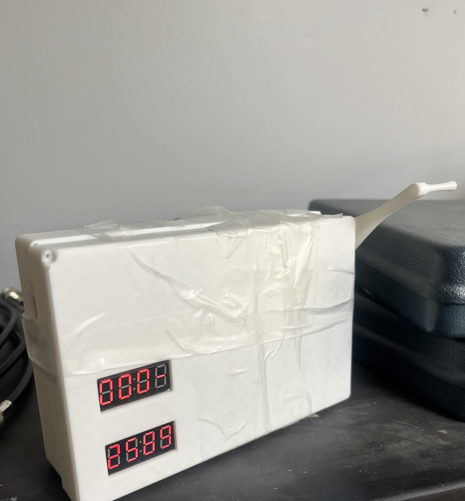
  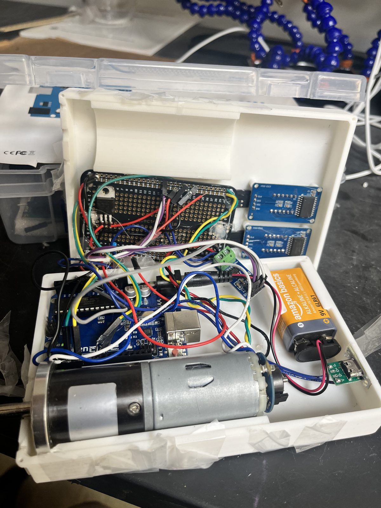
</p>

## The problem

Phones are essential, but battery life is still the limiting factor, and outlets or power banks are not always around: remote areas, travel, emergencies. The statistics below are from an Anker survey, as cited on our project poster.

- 68% of people report their phone dies weekly, and 31% report it dying daily
- 56% say they do not charge their phone until it is under 20%

The HPC is meant for those moments. It needs no outlet and no battery bank, only the person holding it.

## What it does

- Generates power from hand cranking using a 12 V DC gear motor
- Regulates the output to 5 V for a standard USB charging cable
- Shows live **RPM** (input) on one 4-digit LED display
- Shows live **power output** on a second 4-digit LED display
- Fits in a 3D printed PLA enclosure sized to go in a pocket or backpack

## Design targets

These come from the operational requirements in the project report (35 in total, full list in [`docs/`](docs/)). A few of the main ones:

| Area | Target |
|---|---|
| Size | Fits within 6 x 3 x 1.5 in when stored |
| Weight | 350 g or less |
| Output | 5.0 V +/- 5%, USB compatible |
| Power | At least 400 mA continuous at 5 V (about 2 W) at 60 RPM |
| Startup | Delivers power within 5 seconds of cranking |
| Feedback | RPM displayed at 1 RPM resolution, +/- 5 RPM accuracy (20-120 RPM) |
| Ergonomics | 0.35 N·m or less of hand torque at 60 RPM, usable by left or right hand |
| Durability | Survives three 1.0 m drops and a 50 N side load (pocket compression) |
| Safety | Output current limited to 1.5 A, touch surfaces at or below 48 °C |
| Environment | 40-100 °F operating range |

## How it works

The report splits the HPC into three subsystems:

| Subsystem | What it does | Main parts |
|---|---|---|
| **Power** | Turns crank motion into regulated 5 V and delivers it to the phone | Crank, 12 V DC gear motor (generator), 5 V regulation, USB output |
| **Sensory** | Measures RPM and output current, then shows them to the user | Arduino Uno, motor encoder, ACS712 current sensor, two TM1637 LED displays |
| **Physical** | Holds everything together and takes the abuse | 3D printed PLA enclosure (top and bottom shells), crank handle |

```
Crank -> 12 V DC gear motor -> 5 V regulation -> USB output -> phone
              |                      |
        quadrature encoder     ACS712 current sensor
              |                      |
              +------> Arduino Uno <-+
                       |         |
                RPM display   Power display
```

<p align="center">
  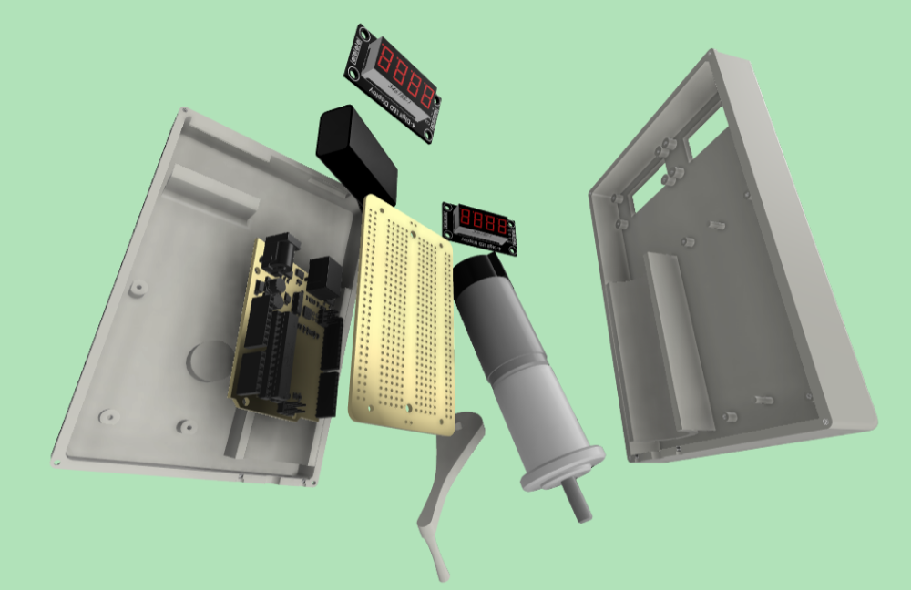
  <br><em>Exploded view from the project poster.</em>
</p>

## Firmware

The Arduino sketch is in [`firmware/HPC_Firmware/HPC_Firmware.ino`](firmware/HPC_Firmware/HPC_Firmware.ino).

### Pin map

| Signal | Arduino pin | Notes |
|---|---|---|
| Encoder channel A | D2 | External interrupt, counts rising edges |
| Encoder channel B | D3 | Set to `INPUT_PULLUP`, not used for counting in this version |
| RPM display CLK / DIO | D4 / D5 | TM1637 |
| Power display CLK / DIO | D6 / D7 | TM1637 |
| ACS712 output | A0 | Configured for 5.0 V reference, 10-bit ADC, 100 mV/A |

The 100 mV/A setting matches the 20 A version of the ACS712.

### How the sketch works

1. Every rising edge on encoder channel A triggers `countPulse()`, which adds one to `pulseCount`.
2. Once per second the sketch pauses the interrupt, converts the count to RPM with `rpm = (pulseCount / pulsesPerRevolution) * 60`, resets the counter, and turns the interrupt back on. The result goes to the RPM display and to the Serial Monitor (9600 baud).
3. On every pass through `loop()` it reads the current from the ACS712 (`ACS.mA_DC(1000)`, averaged over 1000 cycles), multiplies the mA reading by 5 for the regulated 5 V output to get power in milliwatts, and shows that on the second display. A short `delay(250)` keeps the loop from running flat out.

### Things to know

- The second display object is named `dispVolt` in the code, but what it shows is **power in mW** (current x 5 V). That matches the "Live LED Wattage Output Display" on the poster.
- Voltage is assumed to be a steady 5 V. It is not measured, so the power number is only as good as the regulation.
- `pulsesPerRevolution` has to match your encoder and counting method (only rising edges on channel A are counted). If you swap the motor, check this value against a handheld tachometer.

### Build and upload

1. Install the Arduino IDE.
2. In Library Manager, install **TM1637** (by Avishay Orpaz) and **ACS712** (by Rob Tillaart). The sketch uses the `mA_DC(cycles)` call from the 0.4.x versions of the ACS712 library.
3. Open `HPC_Firmware.ino`, select **Arduino Uno**, and upload.
4. Open the Serial Monitor at 9600 baud to see the RPM readout.

## Mechanical design and 3D printing

The enclosure was modeled in Fusion 360 as a two-piece shell (top and bottom) with cutouts for the two displays, mounting posts for the electronics, and a crank handle that attaches to the motor shaft.

| Setting | Value |
|---|---|
| Printer | Elegoo Centauri Carbon, 0.4 mm nozzle |
| Slicer | OrcaSlicer 2.3.1 |
| Material | PLA, 220 °C nozzle |
| Layer height | 0.2 mm |
| Walls | 3 wall loops, 5 top shell layers |
| Infill | 15% gyroid |

Print times from the G-code: bottom shell 2 h 13 m, top shell 1 h 52 m, crank 36 m.

- [`cad/final/`](cad/final/) has the final STLs (top, bottom, handle). Print from these.
- [`cad/earlier-revisions/`](cad/earlier-revisions/) has the first-iteration top, bottom and crank.
- [`cad/gcode/`](cad/gcode/) has the G-code from the November 16, 2025 slicing run. It was sliced before the final STLs were exported, so re-slice if you want to print the final parts.

## Systems engineering process

The project follows the Kossiakoff systems engineering method. The full write-up is in [`docs/HPC_Project_Report.pdf`](docs/HPC_Project_Report.pdf) (53 pages).

1. **Operational scenarios:** three use cases drove the requirements: sitting at a table on campus, standing in a busy city with no surface, and an emergency in the wilderness where the unit gets dropped.
2. **Context diagram:** the HPC and its four outside entities: device, charging cord, user, and environment ([diagram](docs/diagrams/HPC_Context_Diagram_1.png)).
3. **Requirements and functions:** 35 operational requirements traced to top-level functions in a trace matrix ([spreadsheet](docs/HPC_Functional_Requirements_Chart.xlsx)).
4. **Physical architecture:** requirements allocated to the Power, Sensory and Physical subsystems, with an interface table between each pair.
5. **Trade study:** weighted scoring of the major design choices (below).
6. **Risk management:** 16 risks (8 production, 8 consumer) scored before and after mitigation. The biggest one left after mitigation is the device failing after an accidental drop.
7. **Test and evaluation plan:** integration, development, operational and acceptance phases, with three example test events: crank-to-output verification at 80 RPM, display and sensor accuracy, and a three-drop durability test.

### Trade study results

Criteria were weighted on a 1-10 scale, with durability and power efficiency highest (9), then port compatibility (8) and ergonomics (7). Manufacturability had the lowest weight (5).

| Decision | Options compared | Recommended |
|---|---|---|
| Enclosure material | ABS, polycarbonate, aluminum, rubberized plastic, PC + TPU | Polycarbonate with rubber overmold |
| Crank style | Fixed, retractable, foldable | Foldable |
| USB output | USB-A (with or without Quick Charge), USB-C | USB-C |
| Display | LED, LCD/OLED, E-Ink | Reflective low-power display (E-Ink), LED as backup |
| Generator | Brushed DC, brushless DC, stepper, dynamo/alternator | Brushless DC |
| Regulator | Linear LDO, buck, buck-boost | Buck-boost |

The prototype differs from the study's recommendation in a few places, for example LED displays and a 3D printed PLA enclosure.

## Build progress

<details>
<summary>Photos from bench test to finished enclosure</summary>

<table>
  <tr>
    <td align="center">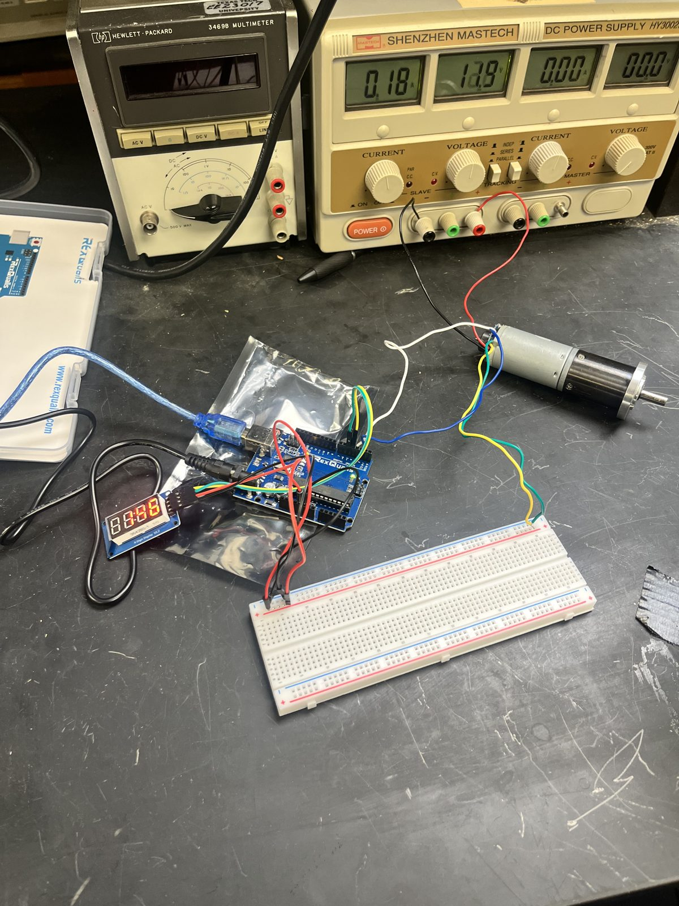<br><sub>Early bench test with a bench power supply and multimeter</sub></td>
    <td align="center">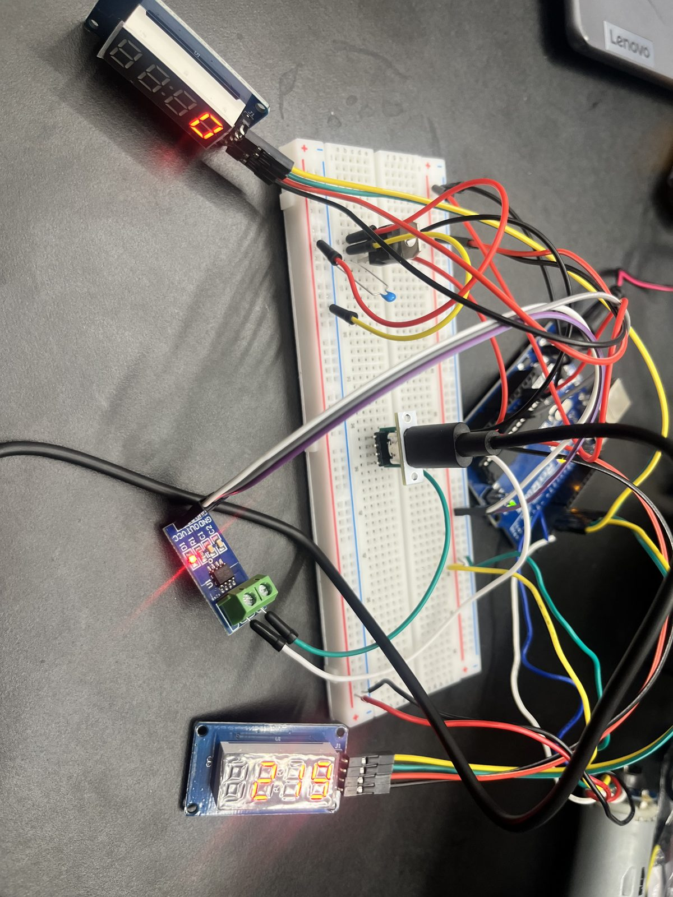<br><sub>Breadboard prototype with both displays and the current sensor</sub></td>
    <td align="center">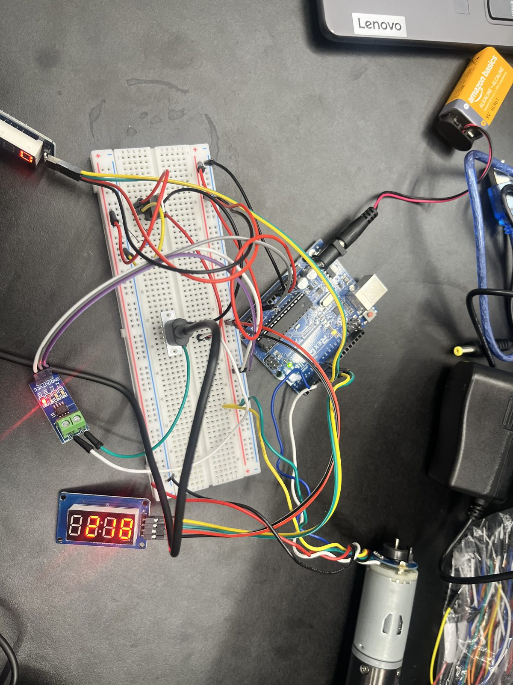<br><sub>Breadboard prototype, second angle</sub></td>
  </tr>
  <tr>
    <td align="center">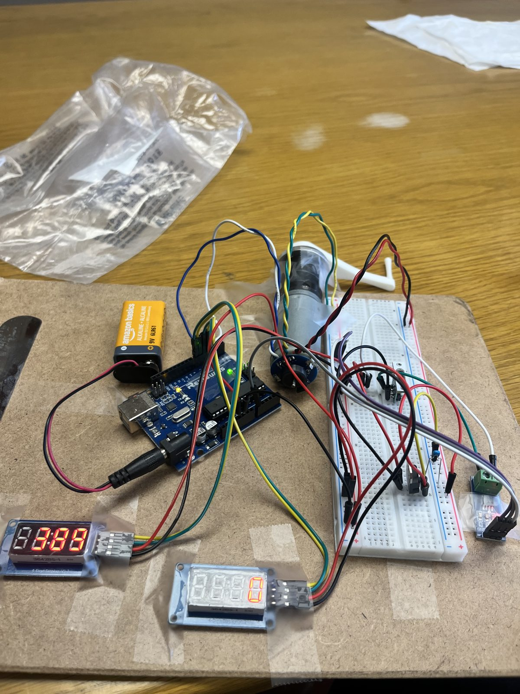<br><sub>Parts mounted on a board with the motor and printed crank</sub></td>
    <td align="center">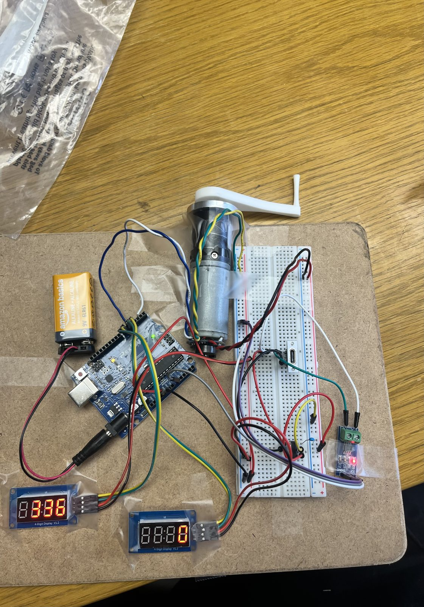<br><sub>Board-mounted prototype from above</sub></td>
    <td align="center">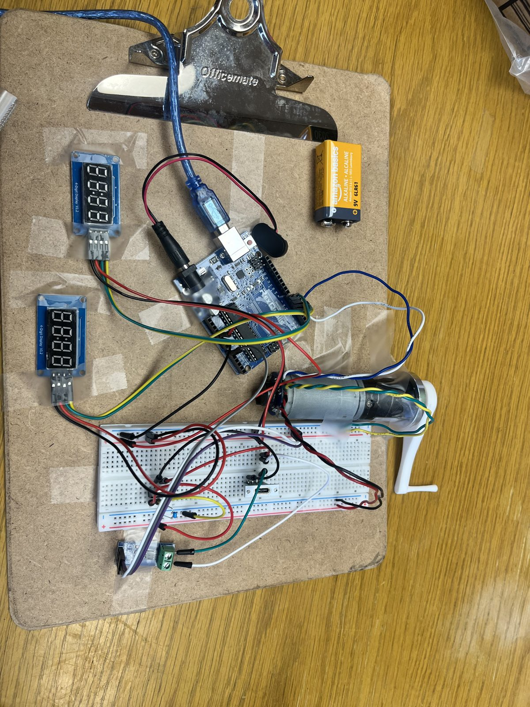<br><sub>Board-mounted prototype, third view</sub></td>
  </tr>
  <tr>
    <td align="center">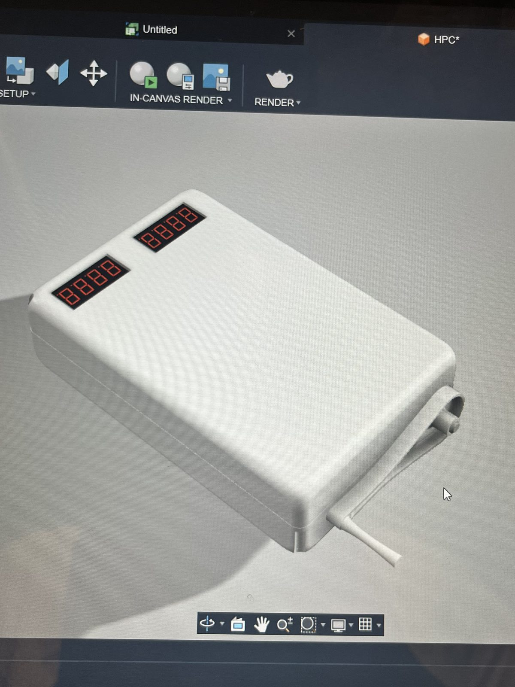<br><sub>Fusion 360 render of the enclosure</sub></td>
    <td align="center"><br><sub>Inside the printed enclosure</sub></td>
    <td align="center">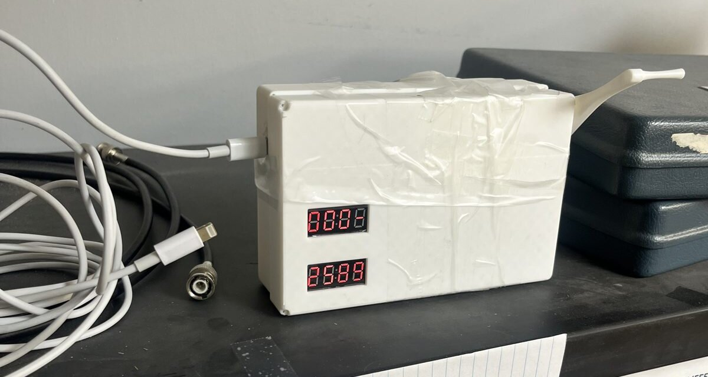<br><sub>Assembled enclosure with a charging cable plugged in</sub></td>
  </tr>
</table>

</details>

**Videos**

- [RPM display bench test](media/videos/rpm-display_bench-test.mp4): motor, Arduino and TM1637 display on a breadboard
- [Two-display test](media/videos/two-display_test.mp4): both displays running with the sensor wiring

## Repository structure

```
Handheld-Crank-Phone-Charger/
├── README.md
├── firmware/
│   └── HPC_Firmware/
│       └── HPC_Firmware.ino        Arduino sketch (RPM + power displays)
├── cad/
│   ├── final/                      Final STLs: top, bottom, handle
│   ├── earlier-revisions/          First-iteration STLs: top, bottom, crank
│   └── gcode/                      Sliced G-code (Elegoo Centauri Carbon, PLA)
├── docs/
│   ├── HPC_Project_Report.pdf      Full engineering report
│   ├── HPC_Functional_Requirements_Chart.xlsx
│   ├── diagrams/                   Context diagrams and early design flowchart
│   └── poster/                     Project poster (PNG, PDF, 3-page PDF)
└── media/
    ├── photos/                     Build photos
    ├── videos/                     Short bench-test clips
    └── images/                     Figures used in this README
```

## Team and credits

**Course:** ENGR 1340-012, Introduction to Engineering Design, Texas Tech University (September 11 to December 2, 2025)

**Team:** Roles below come from the RACI matrix in the project report.

| Name | Planned role (RACI) |
|---|---|
| Ebubechukwu Iwunnah | Circuit modeling and simulation, research on design and materials, physical layout, prototype building and testing, final report approval |
| Quoc "Pilot" T. | Objectives and concept of operations, system context diagram, operational requirements, functional description, data collection |
| Steven F. | Parts procurement, assembly, physical specifications, assembly lead for the prototype |
| Joshua G. | Purchase approval, build completion oversight, report editing and formatting |

**What was actually done:** The planned split changed during the project. I built the prototype, wrote the firmware, modeled and printed the enclosure, and ran the bench tests.

**Libraries and data**

- [TM1637](https://github.com/avishorp/TM1637) by Avishay Orpaz, the driver for the 4-digit LED displays
- [ACS712](https://github.com/RobTillaart/ACS712) by Rob Tillaart, the current sensor library
- Phone battery statistics from an Anker survey, as cited on the project poster

**Tools:** Fusion 360 (CAD), OrcaSlicer (slicing), Elegoo Centauri Carbon (printing), Microsoft Visio (flowchart), Canva (poster)

The trade study and design references are listed in section 12 of the project report.
